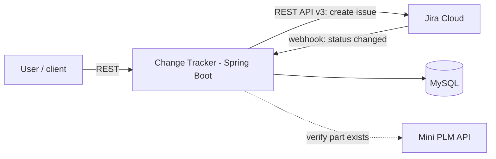
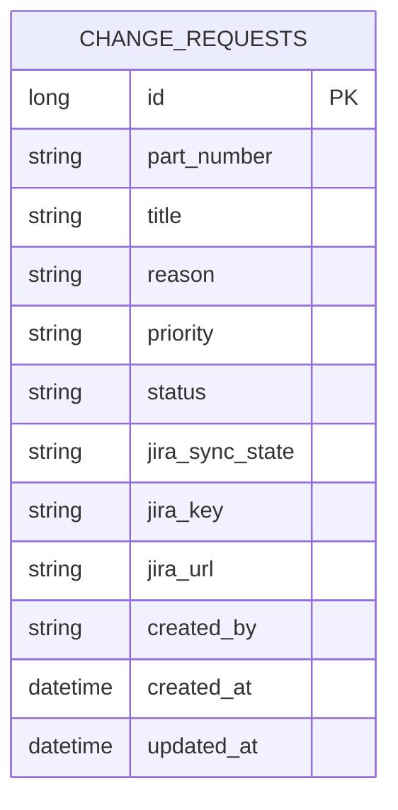

# PLM Change Tracker: Design

## Architecture


Layers: **controller** (HTTP only) -> **service** (business rules) -> **repository** (database). Calls to Jira will sit behind a `JiraClient` interface so tests can use a fake.

## Data model

A second table for status history is added when the webhook is built.

## API
| Method | Path | Purpose | Success |
|---|---|---|---|
| POST | `/api/change-requests` | Create | 201 + Location header |
| GET | `/api/change-requests?status=&partNumber=` | List with optional filters | 200 |
| GET | `/api/change-requests/{id}` | Read one | 200 / 404 |
| PUT | `/api/change-requests/{id}` | Edit title, reason, priority | 200 / 404 / 409 |
| POST | `/api/jira/webhook` | Jira status updates (later ticket) | 200 |
| GET | `/actuator/health` | Health check | 200 |

## Error format
```json
{ "timestamp": "2026-10-11T17:00:00Z", "status": 400, "message": "Validation failed",
  "errors": { "title": "title is required" } }
```
400 = bad input, 404 = not found, 409 = rule broken (for example editing a closed request).

## Decisions
- **Save first, call Jira second.** A Jira outage must never lose a request, so the row is written with sync state `PENDING` and the Jira call follows.
- **Part numbers upper-cased** on write so `p-1` and `P-1` are the same part.
- **Secrets from environment variables** only.
- **Port 8081**, so it can run beside Mini PLM (8080).
